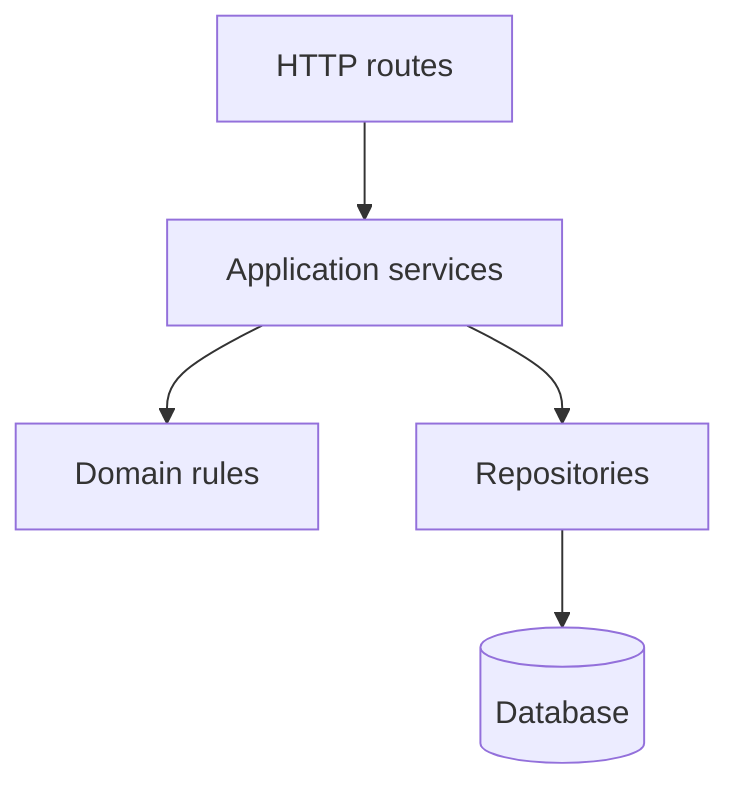
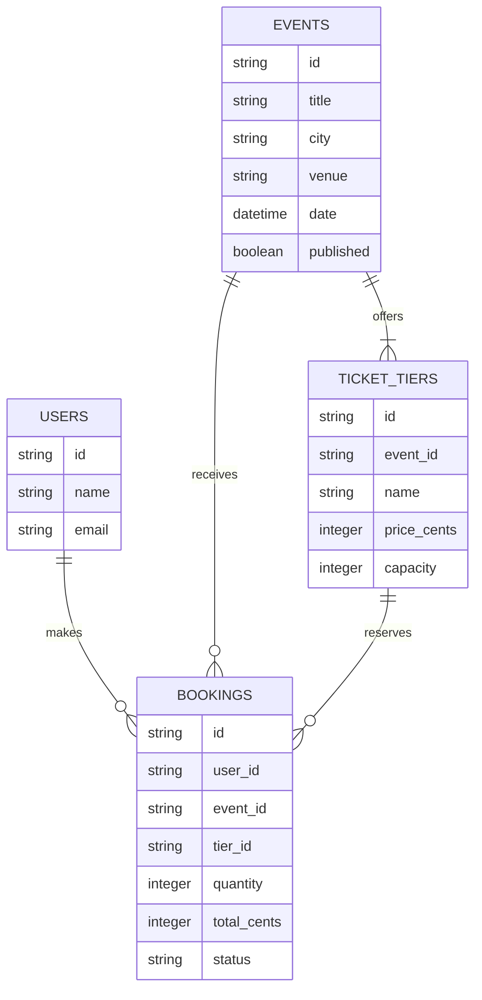
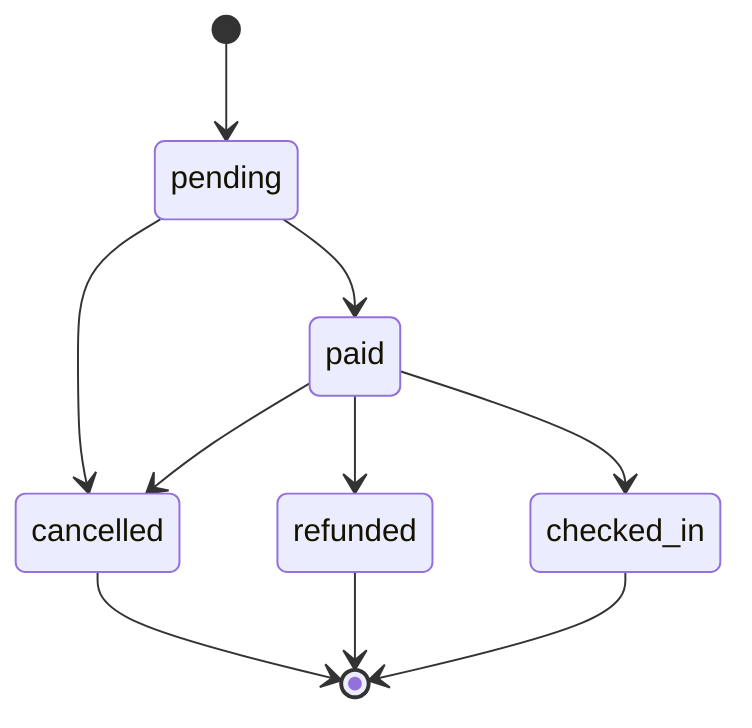

# Build 3 architecture

## Layers

- **Routes** may validate HTTP-level input and translate requests and responses; they may not contain business rules or access repositories directly.
- **Services** may coordinate domain rules and repositories; they may not depend on routes or HTTP details.
- **Rules** may enforce business invariants using supplied data; they may not perform I/O or call services, routes, or repositories.
- **Repositories** may load and save data; they may not own business decisions or call services, routes, or domain rules.
- **Database** may persist data; it may not call application layers.

## Data model

## Booking life cycle

